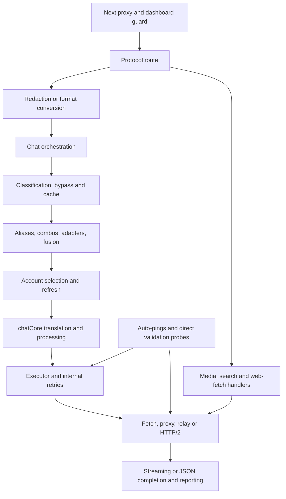

# Fleet plugin architecture and host attachment survey

Status: proposed integration architecture; no runtime hooks are installed by this
survey. Inspected 2026-10-31 against HEAD `325190b`, krouter-app 0.5.166, with the
working-tree dependency changes left intact. Requirements originate in
[the fleet design](FLEET_ROUTER_DESIGN.md) and
[the OpenSpec change](../openspec/changes/fleet-router-governance/proposal.md).

## Architectural decision

Implement fleet governance as a trusted, in-process plugin behind a small versioned
host interface. Keep policy, canonical identity, logical sessions, selection,
funding, E2EE and decision records in the plugin. The host owns request parsing,
protocol translation, existing routing strategies, credentials, transport and
stream plumbing. Host edits introduce explicit lifecycle calls at the attachment
points below. An HTTP wrapper or executor-registry decorator cannot enforce the
complete contract on this codebase.

Use a repository-local module first; extracting it as a package can follow once
the host contract is stable. Suggested locations, all **proposed**:

```text
plugins/fleet-router/          plugin implementation and plugin-owned migrations
open-sse/runtime/              framework-neutral host contract and attempt runner
src/lib/routerHost/            Next/auth/DB/config adapters and request wrapper
src/instrumentation.js        readiness registration, if selected during implementation
tests/fleet/                  host conformance, negative dispatch, recovery fixtures
```

`open-sse/runtime` must not import the fleet implementation or Next.js. The
composition root supplies one configured enforcement plugin and narrow host ports.
The plugin must not import route modules or mutate executor singletons. Avoid a
general event bus: mandatory decisions are awaited hooks with defined failure
semantics; best-effort observers cannot grant admission. This is a logical module
boundary, not a sandbox against malicious code in the same process.

## Current request and execution topology



This diagram describes the current ordering, not the target authorization order.
In particular, enabled route redaction can disclose content to Presidio before
`handleChat` performs its handler-level API-key check. Next's outer guard offers
additional protection, but does not resolve fleet processing permissions.

### Findings that determine the hook boundary

- OpenAI chat, Responses, Responses compact, Anthropic messages and Ollama-shaped
  chat converge on `handleChat`, but each has route-level processing first.
  Gemini converts and reconstructs a Request before redaction and chat handling.
  Original intent, abort signals and trusted context must survive those steps.
- Local intent/complexity classifiers are already invoked in the chat handler.
  The nearby comment describes an opt-in setting; the inspected block has no
  setting or policy check. Treat permission gating as a real behavior change.
- Cache hits and naming/warmup bypasses return before upstream execution.
  Model enforcement and scoped response authorization cannot live solely in an executor.
- `handleSingleModelChat` recursively expands combos and separately executes an
  emergency model. Fusion schedules panel calls and a judge through the supplied
  callback, without a distinct trusted execution-role argument today.
- `chatCore` retries after credential refresh, but one executor invocation may
  generate multiple inference transmissions: base URL/retry loops, extra API-key
  rotation, stripped-field/tool/image repair, Antigravity retry, MiMo token retry,
  and Kiro integrity repair. Account/credential identity can change below chatCore.
- Cursor has a native HTTP/2 path. Other executors use direct fetch or
  `proxyAwareFetch`; media, search and fetch have independent dispatchers.
  `proxyFetch.js` patches global fetch, which supplies network behavior, not
  principal/model/funding context. It also captures the original fetch and has
  relay, proxy and bypass paths. Patching it alone cannot prove coverage.
- Quota auto-ping sends Claude inference directly and invokes the Codex executor.
  Provider validation also contains direct inference/search/media probes. These
  require an explicit system principal and funded scope rather than exemption.
- Stream success currently means a Response can be returned; the full stream may
  still fail or be cancelled. `onRequestSuccess` is an account-health callback,
  not financial settlement. Usage and detailed payload logging occur in several
  response paths and must be governed independently.
- App bootstrap is imported from the root layout and launches background services.
  It is not a suitable sole readiness gate for requests that arrive without a
  prior page render. Initialization also catches errors, so mandatory plugin
  readiness must have its own awaited state and failure behavior.

## Attachment register

The machine-readable companion
[attachment-points.json](../openspec/changes/fleet-router-governance/attachment-points.json)
records exact files, symbols, existing test references and proposed conformance
cases. IDs identify the host boundaries; none is implemented yet.

| ID | Existing attachment | Host obligation / plugin responsibility |
| --- | --- | --- |
| H01 | `src/shared/services/bootstrap.js`, `initializeApp`, root layout | Register plugin once per server instance; await readiness/recovery independently at every governed ingress and before background inference. Stop new admission on shutdown. |
| H02 | Protocol `route.js` exports; `dashboardGuard`, rewrites | Establish trusted principal and RequestContext before body-dependent processing. Cover literal/rewrite aliases; strip untrusted internal metadata. |
| H03 | `withRedaction`, Gemini conversion, compact/Ollama Request reconstruction | Authorize processing destinations before sidecar calls; preserve original selection, signal, trusted scope and protocol through conversion. |
| H04 | `handleChat` classifier, `handleBypassRequest`, cache lookup | Gate semantic analysis and authorize every early response; cache/synthetic responses still obey scope, identity and privacy. |
| H05 | `getModelInfo`, alias/combo repositories, model catalogs | Resolve canonical identity without losing original exact/family intent; version registry/equivalence separately from display catalogs. |
| H06 | `handleComboChat`, capacity adapter, nested combo callbacks | Filter eligible candidates before rank/rotation and repeat enforcement after substitution; retain existing strategy inside the allowed set. |
| H07 | `handleFusionChat` panel and judge callbacks | Create trusted child roles and IDs, separately authorize judge/analysis, reserve each participating call; timed-out panel calls remain accounted for. |
| H08 | `getProviderCredentials`, quota preflight, token refresh | Intersect account eligibility with policy; quotas remain advisory inputs. Bind actual account and rotated key to admission; recheck after awaits. |
| H09 | `chatCore` transformations and request logger | Authorize RTK/Caveman/Ponytail/Headroom/PXPIPE and content sinks before execution; produce a bounded final request plan. |
| H10 | `chatCore` executor calls and refreshed-credential retry | Carry context into executors; create a new attempt for each inference transmission, including refresh retry and emergency execution. |
| H11 | `BaseExecutor.execute` loops and repair sends | Re-admit/revalidate every actual POST with final URL, model, effective credential reference and body semantics; no permit reuse. |
| H12 | Specialized executors, Cursor H2, proxy/relay transports | Route every concrete inference transmission through an authorized attempt runner; verify actual processing destinations and protect/decrypt provider traffic. |
| H13 | Streaming, JSON, forced-SSE handlers and usage/detail sinks | Verify/decrypt before translation/logging/release; normalize usage, record outcome and reconcile exactly once; retain exposure on uncertain termination. |
| H14 | Embeddings core and credential-refresh retry | Attach the same request/attempt lifecycle; keep exact embedding usage, enforce unsupported privacy requirements before fetch. |
| H15 | Images, STT, TTS cores and provider adapters | Cover no-auth/local branches, multipart, uploads/polls and provider-specific HTTP; bound price in native billable dimensions. |
| H16 | Video create/edit/extend/status core | Bind asynchronous jobs to authorized scope and exposure; enforce refresh retries, status/asset access, and no blind resend of uncertain creation POSTs. |
| H17 | Search dedicated/chat wrappers; web fetch | Cover `fetchPublic`, chat-search fetch and each fetch backend; preserve SSRF protection while authorizing destinations, pricing and retries. |
| H18 | Auto-pings, provider validation, model testing, token warmer | Distinguish inference probes from credential/catalog/quota control traffic; assign system principal/budget to inference; avoid double admission for HTTP self-calls. |
| H19 | DB driver/migrations, sessions, usage/pricing repos | Provide narrow durable storage, price/quota and identity ports. Plugin owns policy/session/ledger state; reports never authorize spend. |
| H20 | Management APIs/dashboard, observability, MITM ingress | Add authorized plugin administration and content-free records; preserve host auth. MITM-routed requests re-enter ingress; direct passthrough is a separate uncovered process boundary. |

## Versioned host contract

The first contract version should expose these semantic operations. Names are
proposed API names; their required ordering is part of the OpenSpec host contract.

| Operation | Input and result | Required behavior |
| --- | --- | --- |
| `register(hostPorts)` / `ready()` | Contract version, coverage manifest, storage, identities, pricing, clock, crypto/transport factories, decision sink | Reject incompatible contract or incomplete coverage for configured governed traffic. Recover reservations before admission. Never initialize from an optional dashboard render alone. |
| `openRequest(envelope)` | Trusted principal, origin, protocol, immutable original selection, task/session scope, abort signal → RequestContext | Resolve effective policy; no ordinary diagnostics or optional content processing before this boundary. Do not trust a body/header to assert internal/system authority. |
| `authorizeProcessing(ctx, operation)` | Kind, content classes, destination, retention → permit/deny | Covers local classifiers, external analysis, transformations, logs, caches and asset fetches. Permit is specific to the declared processing action. |
| `filterCandidates(ctx, candidates, role)` | Canonical models, provider/account options, capabilities → allowed subset/reasons | Pure eligibility before ranking; recheck at dispatch. Auxiliary roles are trusted host data, never caller flags. |
| `authorizeResponse(ctx, provenance)` | Actual canonical model, privacy evidence, scope, synthetic/cache source → permit/deny | Required before serving cached or synthetic content; a cache hit does not fabricate a provider charge/reservation. |
| `runAttempt(ctx, plan, send)` | Final request descriptor and controlled transport callback → verified Response/outcome handle | Reserve before chargeable execution; bind final effective identity and destinations, apply protocol encryption after provider transformation, revalidate current policy after setup awaits, consume one permit at send. No detached raw-network callback is exposed to the plugin policy layer. |
| `completeAttempt(handle, outcome)` | Raw normalized usage, confidence, terminal/uncertain state, remote job ID → durable acknowledgement | Idempotent durable reconciliation, including failures and cancellation. Detailed reports can be best-effort only after required state is safely recorded. |
| `closeRequest(ctx, outcome)` / `shutdown()` | Request termination or server lifecycle | Request closure is distinct from attempt settlement. Drain/retain exposure; cancellation does not imply free execution. |

Host ports are capabilities, not raw access to route modules: principal validation,
canonical/catalog lookup, policy storage, durable transaction/recovery, price/quota
snapshots, credential references, controlled transport, clock and decision sink.
Actual provider secrets enter only the restricted host/crypto transport adapter as
needed; policy callbacks and ordinary records receive opaque references. A rotated
key must have a stable reference so sub-account pricing/limits can be enforced.

RequestContext is server-created and passed explicitly across asynchronous calls,
Request reconstruction, recursion and stream closures. It contains IDs/references
and policy versions, not provider secrets. AsyncLocalStorage may aid correlation
but cannot be the sole source of authorization, especially across Next Proxy,
worker/process boundaries and detached background work. The installed Next guide
explicitly warns against relying on shared Proxy globals/modules. No unverified
forwarded header can recreate trusted context.

## Attempt and transport semantics

1. Authenticate, bind scope and authorize required preprocessing; structurally
   parse without treating analysis as implicit consent.
2. Generate/filter candidates, choose permitted accounts and funding, and plan
   provider transformation. Bound the final chargeable operation, including native
   image/audio/video/search units. A changed model/body/credential invalidates an
   old plan or permit.
3. Reserve atomically; perform authorized E2EE key/attestation setup without
   disclosing prompt content. Encrypt the final provider payload. Revalidate current
   policy/reservation and consume the permit immediately before transmission.
4. Decrypt/verify the returned body before format conversion, content diagnostics,
   cache insertion or release. Keep existing protocol translation above this layer.
5. Persist raw usage/outcome before optional reporting. A new actual inference send
   gets a new attempt ID and admission. Parent request/operation IDs correlate all
   retries, panel calls, async job actions and reconciliation.

The transport adapter must distinguish logical target, physical proxy/relay and
all parties able to see plaintext. Proxy fallback, native H2, redirects, image URL
downloads, secondary uploads, polling and downloads must not create unreviewed
destinations. Preserve existing SSRF and strict-proxy controls. Disable automatic
redirect/retry behavior on governed paths unless each destination/transmission is
explicitly covered. Do not put encryption before an executor that will subsequently
rewrite the body or log its plaintext.

For internal retry loops, prefer migrating concrete sends to the common attempt
runner rather than removing their provider-specific recovery logic. Providers not
yet migrated are unavailable for governed execution; the plugin must never label
an executor covered merely because its outer `execute` call is wrapped. A retry
with uncertain prior exposure retains the old reservation and requires a new one
unless authoritative provider idempotency establishes safe reuse.

For async jobs, persist the upstream job ID under principal/task/funding scope.
Status/asset access must not let a caller bind another principal's job. Polling or
upload actions have explicit operation classes, cost bounds and destination policy;
an entire workflow and each billable step are both accounted for without double debit.

## Loading, failure and deployment behavior

- Plugin disabled on explicitly unmanaged traffic: host preserves legacy behavior.
  Governed requirements must not silently disappear when plugin configuration is
  missing, initialization fails or contract versions differ.
- Plugin required but unavailable/incompatible: readiness rejects or governed
  request returns a typed unavailable error before content processing/network.
- Mandatory hook failure/timeout: deny; pre-send holds release only when execution
  is known not to have occurred. After possible transmission, retain exposure.
- Unsupported route/provider/transport/payload: explicit capability rejection for
  governed requests. Configure an initial coverage allowlist rather than a global
  claim that every installed provider is governed.
- Additive plugin-owned migrations, namespaced settings/tables, and explicit
  durability checks. Do not overload user-editable usage history as the ledger.
  sql.js delayed file export is not an approved hard-budget durability guarantee.
- Prefer Next `instrumentation.register` as the framework readiness composition
  point, subject to an API-first standalone packaging test, plus awaited request
  readiness. Installed Next docs say registration completes before server readiness.
  Do not move all existing tunnel/MITM bootstrap side effects as part of this work.
  Verify build/prerender never starts plugin workers, applies live migrations or
  performs provider calls; readiness registration must stay server-runtime scoped.
- Register once per server instance and support worker/HMR isolation; ledger and
  policy state must remain authoritative across instances. Shutdown and rollback
  stop admissions before draining/recovering; they never delete outstanding holds.
- Same-process plugin scope excludes direct MITM passthrough, unrelated host tools
  and spending using shared credentials elsewhere. Route governed MITM inference
  through the protected router, or explicitly disable/reject uncovered passthrough.
  A separate process must authenticate at ingress or use a separately specified
  authenticated context protocol; it cannot share JavaScript request context.

## Tie-in test plan

Each attachment register entry names existing regression evidence and future
conformance case IDs. New hook integration must pass executable behavioral cases;
source-text assertions or mocked helper decisions do not prove actual enforcement.
The [integration matrix](../openspec/changes/fleet-router-governance/integration-matrix.md)
maps each delta capability and S-01–S-16 acceptance scenario to these boundaries.

| Suite to add | Critical cases |
| --- | --- |
| `host-lifecycle` | API-first boot without dashboard, disabled unmanaged parity, incompatible plugin, concurrent init/HMR, required-plugin failure, shutdown/recovery ordering. |
| `ingress-processing` | Every protocol/rewrite alias; unauthorized Presidio/classifier/Headroom/PXPIPE/log sink receives zero content; spoofed principal/system role rejected; Request clones retain signal and trusted original intent. |
| `routing-constraints` | Exact/family through aliases, nested combos, adapter, emergency, account rotation and fusion; separately authorized panel/judge; policy tightening before the next send. |
| `attempt-transports` | Initial/refresh/base-URL/repair/integrity retry each triggers admission; extra-key identity bound; H2, fetch, relay/proxy fallback, redirects and no-auth provider branches covered; denied send count is zero. |
| `completion-ledger` | JSON, SSE and forced-SSE; terminal/cancel/error races; final usage emitted before disconnect; no duplicate debit; raw versus estimated versus client-buffered usage; crash-safe uncertain exposure. |
| `media-jobs` | Multipart STT upload/submit/poll, image URL fetch, TTS variants, video create/status/assets and refreshed credentials; job ownership; uncertain creation is never blindly resent. |
| `system-operations` | Auto-ping and validation probes require system policy/budget; token refresh/catalog lookup classified separately; self-HTTP calls do not create duplicate reservations or trust caller-supplied internal flags. |
| `plugin-isolation` | Two parallel principals, sessions and streams cannot exchange context; host never imports plugin policy directly; absent coverage cannot advertise enforcement. |

Use fake network transports with an ordered call journal and unique content/secret
sentinels to prove deny-before-disclosure and lifecycle ordering. Exercise actual
handlers/executors rather than reproducing their conditions in the test. Stream
fixtures must be fully consumed/cancelled and verify terminal client bytes as well
as durable outcome. Real temporary durable databases and process-kill/restart tests
are required for funding; mocked transactions cannot establish crash safety.

Static architecture checks can additionally inventory direct inference sends and
prevent new unregistered attachments, but remain supplementary to behavior tests.
No full AST/network coverage checker is implemented by this documentation change.

## Implementation slices

1. Define host contract, fake plugin, trusted context and readiness. Verify required
   versus unmanaged behavior and two-request isolation before adding policy logic.
2. Attach ingress/processing/early-response and candidate hooks across chat routes;
   implement deterministic constraints with real negative dispatch tests.
3. Migrate base executor and every specialized concrete send to the attempt runner;
   include refresh, repairs, probes and alternate transports. Declare only verified
   coverage; deny governed traffic elsewhere.
4. Attach completion/reconciliation and durable storage; deliver actual funding
   enforcement before admitting hard-cap traffic.
5. Add the dedicated E2EE provider adapter and verified stream boundary, followed
   by durable sessions, permitted analysis and management UI.
6. Extend the same host contract to each media/search/job workflow with its native
   pricing and privacy semantics; prove scope before widening the coverage allowlist.

## Verification from this survey

Two targeted Vitest runs passed: **32 files, 362 tests**. The selected cases cover
existing routing/adapters/quotas/sessions/cache/usage, compatible connections,
strict-proxy propagation and refresh, rewrite coverage, JSON/SSE response shapes,
stream aborts, embeddings, search/fetch lock scopes, images/video, Presidio,
background configuration/token refresh, and selected provider repair/retry paths.

Some passing cases are helpers or source checks: notably emergency-fallback
"wiring" tests simulate caller conditions; search/fetch lock tests partly inspect
source, and auto-ping configuration tests do not execute the scheduler. Their names
must not be treated as end-to-end enforcement evidence. No fleet hooks exist yet,
so these runs establish regression starting points, not passing fleet conformance.
No live provider requests, runtime rebuild, restart or production changes were made.

Reproduction commands and per-attachment evidence are recorded in
[verification.md](../openspec/changes/fleet-router-governance/verification.md).
